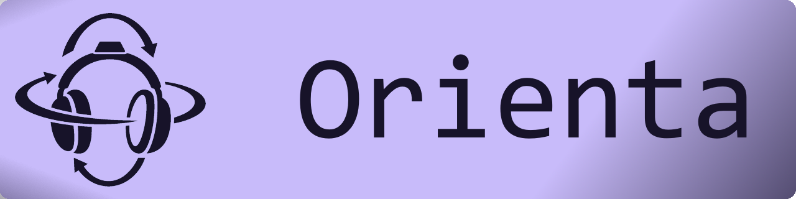
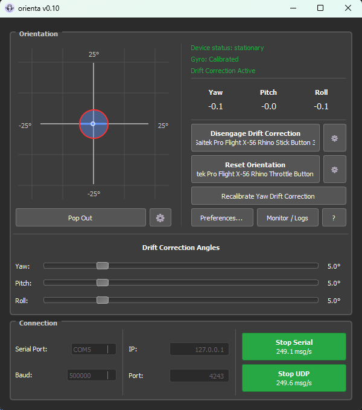

# Orienta




Orienta is a 3-DOF head-tracking application for Windows.
It reads accelerometer and gyroscope data from a serial-connected IMU, estimates
yaw, pitch, and roll with a complementary filter, and can send orientation data
to opentrack over UDP or directly to compatible games using FreeTrack 2.0 or
NPClient.



## Why? 

The idea is to be able to track your head movements in games. Some huge names in the business are trackIR and Tobii, but their complete kits can be quite expensive, making the cost of entry into immersive simulation games quite high. 

While you can build your own kit, you would typically need an IR-sensitive camera with a high frame rate, carefully consider camera distance to head, design a clip for holding the 3 LEDs - it's possible, but can be tricky to get good results with. 

The space between these options is where Orienta could work for you. While there are some shortcomings to using an IMU, the arguments for it are compelling: You can build your own for probably under 15$, are completely free of any camera or viewing angle calculations, it works the same whether your room is brightly lit or pitch black, and can track your head movements at over 240hz, giving you a buttery smooth experience. 

The only diy required is soldering up your sensor and your board and mounting it to your headset. Example included further below. 

## Features

- Real-time serial IMU acquisition with support for a wide range of sensors
- Quaternion-based complementary-filter implementation
- Gyro-bias calibration and correction
- Smooth autocentering when stationary and near center
- UDP output for opentrack, direct FreeTrack 2.0 output, and NPClient output
  for TrackIR-compatible games
- PyQt5 interface with light and dark themes.

## Installation

### Install script for developing

`build\dev\setup_dev.bat` creates a virtual environment, installs application
and native-build dependencies, builds/tests the x86 and x64 FreeTrack and
NPClient clients, and creates a launcher and optional desktop shortcut.

### Manual installation

```powershell
git clone https://github.com/anmagx/Orienta
cd Orienta\build\dev\
python -m venv .venv
.venv\Scripts\activate
python -m pip install -r requirements.txt
cd ..\..\
build\build_game_clients.bat
python orienta.py
```

### Portable executable

After running `build\dev\setup_dev.bat`, build a single-file, windowed executable with:

```powershell
build\build_exe.bat
```

The script installs the pinned build requirements, builds the x86 and x64
FreeTrack and NPClient client DLLs using
`build\build_game_clients.bat`, and creates
`build\dist\Orienta-<version>.exe` from `build\orienta.spec`, using the
`APP_VERSION` in `src\config\config.py` for both the filename and Windows
file/product version. The executable includes the application icon, logo,
themes, FreeTrack and NPClient game-client DLLs, and the FaceTrackNoIR game
response catalog with its permission notice. Preferences, logs, and staged
client files are stored outside the executable, as described in
[User data](#user-data).

## Requirements

### Software

- Windows Operating System
- Python
- PySerial
- PyQt5
- Keyboard
- Pygame
- PyInstaller
- Zig (installed automatically from the pinned build requirements)

### Hardware and serial format

Any device that emits numeric CSV values on a serial port is supported.
The bundled firmware is an ESP32-C3 Super Mini example using a FastIMU-supported
MPU6500, configured to run at 500000 baud. The project prototype used an Arduino Nano. The sensor data must be structured as follows:

```text
time_seconds,accel_x,accel_y,accel_z,gyro_x,gyro_y,gyro_z
```

Accelerometer values are expected in g units and gyroscope values in degrees
per second. Configure the serial port and baud rate in the application to
match your device.

Magnetometers are currently not supported. 

## Usage

You will obviously need to find a way to mount your sensor on your head. In the example I use a 3D-printed case for the sensor itself and the arduino nano that both clip to my headset. Many, if not most IMUs will want to be mounted a specific up-direction to give accurate accelerometer readings - tilted on the side or on it's head will probably not work, but flipped 180° is fine. The app allows for flipping axis in the preferences section. 

1. Flash the supplied Arduino sketch, or connect a compatible IMU source.
2. Select its serial port and baud rate, then start the serial reader.
3. Keep the device still and level while calibrating all three gyro biases (X/Y/Z).
4. Mount the device and reset orientation as needed.
5. In the Connection panel's Output section, select UDP (opentrack),
   FreeTrack 2.0 (Direct), or NPClient (TrackIR-compatible), then start output.
6. For UDP, configure OpenTrack to receive packets at the selected address and
   port. For direct FreeTrack or NPClient, enable output before starting the
   game. Orienta stages and registers the selected game-client DLL while output
   is active, then restores the previous registration when output stops. Keep
   Orienta running while the game uses tracking.

Close the game before using a newly built Orienta version: Windows cannot
replace a client DLL while the game has it loaded. Registration failures
appear in the message panel and application log.

Orienta outputs zero translation and orientation as yaw, pitch, and roll.
Direct FreeTrack output uses Orienta's FreeTrack client DLL for games that load
the FreeTrack interface. NPClient output exposes the same shared-memory poses
through a TrackIR-compatible NPClient interface. Neither direct path requires
the OpenTrack application.

When stationary and near center, center assist gently attracts orientation
toward the configured rest pose. The selected curve ramps up engagement;
attraction continues afterward rather than stopping at the smoothing time.
Smoothing time controls engagement and the sustained correction rate, while
strength scales that rate. Center assist is not an absolute yaw reference and
can pull small held glances inward. Recenter preserves gyro calibration; a
full reset clears all three bias estimates.

### User data

Preferences and logs are stored in `%LOCALAPPDATA%\Orienta`, for both build/dev
and packaged executable runs. The directory is created automatically:

- `config.cfg` stores user preferences.
- `orienta.log` stores application logs; rotated logs remain in this directory.
- `FreeTrackClient\` contains Orienta's x86/x64 FreeTrack game-reader DLLs,
  staged when direct FreeTrack output is enabled.
- `NPClient\` contains Orienta's x86/x64 NPClient DLLs, staged when NPClient
  output is enabled.
- `NPClient\NPClient.log` records first NPClient calls, shared-memory outcomes,
  and sampled source/converted pose values for diagnostics.
- The bundled FaceTrackNoIR game catalog supplies per-game FreeTrack response
  tables; its attribution and permission notice is included in the package.
- `FreeTrackClient\FreeTrackClient.log` records whether a game loaded the
  FreeTrack client and whether it could read the shared-memory pose.

The NPClient implementation is derived from uglyDwarf's LinuxTrack work under
the MIT license. Attribution and license terms are included in
`native\npclient`.

If `LOCALAPPDATA` is unset, Orienta uses `AppData\Local\Orienta` under your home directory. 

### Demonstration Video

Check out the example device in action here! 

## License

Orienta is distributed under the [MIT License](LICENSE).
